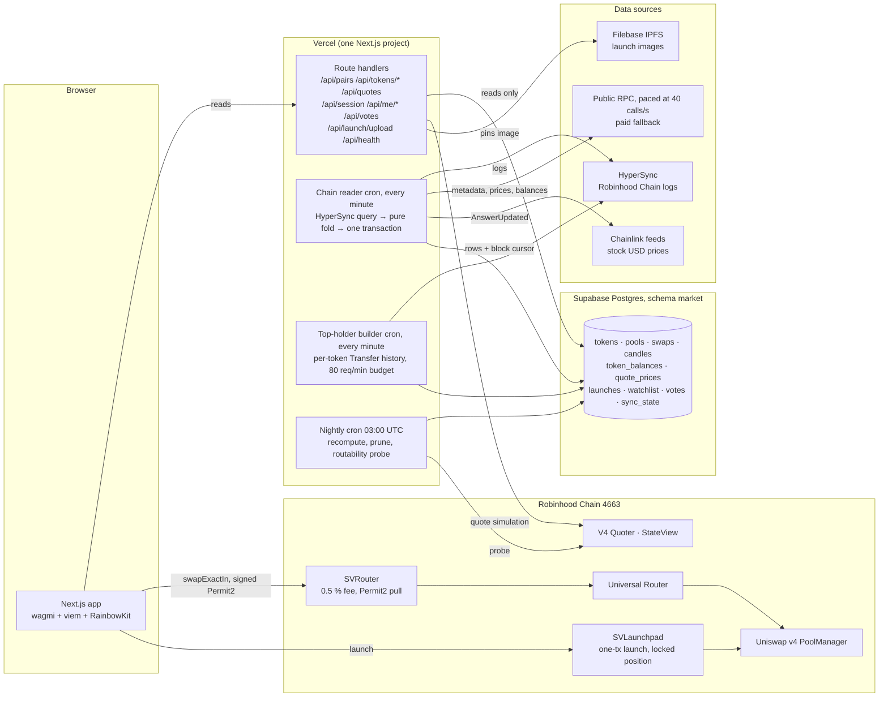

# MaxLong Markets

**A stock-paired token market on Robinhood Chain: every Uniswap v4 pool quoted in a tokenized stock or USDG, from every launchpad, in one table, with its own fee router, a social layer and an instant launchpad.** Built by SuitVentures for MAXLONG between 10 September and 23 October 2026 by one developer, from a fixed-price brief to a live product and a client handoff.

Live: **https://www.maxlong.markets** · Chain: Robinhood Chain (id 4663, an Arbitrum Orbit L2) · Explorer: [robinhoodchain.blockscout.com](https://robinhoodchain.blockscout.com)

This is the umbrella repository. It holds the system-level README you are reading, the build record and Decision Log, the research that drove the two hardest decisions, and the application repositories as git submodules. Each application repository has its own README and its own `SECURITY.md`.

---

## What it does

1. **Lists every stock-paired pool.** Every Uniswap v4 pool on the chain with exactly one allowlisted quote side (Robinhood tokenized stocks such as PLTR, NVDA, SPCX, and USDG) appears, whichever launchpad created it: LONG, Pons, a plain Uniswap deployment, or this product's own launchpad. One row per token, ranked by a primary-pool rule, filterable by quote asset and origin, searchable, with candles at five intervals, trades, holders, liquidity and USD prices from Chainlink tokenized-equity feeds.
2. **Routes swaps** through `SVRouter`, a thin fee wrapper in front of the Uniswap Universal Router: it pulls the input through Permit2, keeps a 0.5 % fee (capped in the bytecode, can only be lowered), forwards an exact-input v4 swap with the user as recipient, and never holds a token or grants an allowance after the transaction.
3. **Adds a social layer.** Sign-In with Ethereum, a server-side watchlist and one bullish or bearish vote per token per wallet, with public counts on the table.
4. **Launches tokens in one transaction.** `SVLaunchpad` deploys a 1 B-supply token, opens its v4 pool at the valuation the creator picks, and places the whole supply in a single-sided full-range position the contract has no code to withdraw. Trading fees split 70 / 30 between the creator and the platform and are collectable by anyone.

## Screenshots

Taken from production on 27 October 2026.

| Markets table (1440 px) | Token page: chart, trades, trade panel |
|---|---|
|  |  |

| Launch a token | A launched token (origin chip SUITS, 1 % pool fee) | Phone width |
|---|---|---|
|  |  |  |

## Repositories

| Repository | What it is | Status |
|---|---|---|
| [suitventures-markets-frontend](https://github.com/maxlong-markets/suitventures-markets-frontend) | Next.js 16 app, the API route handlers, the chain reader and the top-holder builder that run as Vercel crons, the Supabase schema and migrations, the fork harness. | Live on Vercel. |
| [suitventures-markets-contracts](https://github.com/maxlong-markets/suitventures-markets-contracts) | Foundry. `SVRouter` (the fee router), `SVLaunchpad` and `SVLaunchToken` (the instant launchpad), deploy scripts, unit, fuzz, invariant and mainnet-fork tests. | Both contracts deployed and in use. CI runs the build with size checks and the offline tests. |
| [suitventures-markets-indexer](https://github.com/maxlong-markets/suitventures-markets-indexer) | The first data layer: an Envio HyperIndex indexer. | Decommissioned 21 September 2026, superseded by the chain reader in the frontend. Kept as the record of the first approach and why it was replaced. |
| this repository | System README, [build record and Decision Log](docs/decision-log.md), [research](research/), [proposals](proposals/). | |

Deployed contracts on chain 4663:

| Contract | Address | Since |
|---|---|---|
| `SVRouter` | [`0xc9E6b76aA834e746080b1F8Ad6943930eD5147a9`](https://robinhoodchain.blockscout.com/address/0xc9E6b76aA834e746080b1F8Ad6943930eD5147a9) | 18 September 2026 |
| `SVLaunchpad` | [`0x7885AFbda28F5a4d5c6Cc4230975c983d6c7aA0d`](https://robinhoodchain.blockscout.com/address/0x7885AFbda28F5a4d5c6Cc4230975c983d6c7aA0d) | 29 September 2026 |

Contracts used as-is: Uniswap v4 PoolManager `0x8366a39CC670B4001A1121B8F6A443A643e40951`, Universal Router `0x06AfBA43Fd06227fA663b0DAecF536f6EaA6bf99`, canonical Permit2, V4 Quoter and StateView, the Chainlink tokenized-equity feeds, The Suits NFT `0x05c2174aa494bbdf72aeeab0ca3c10216d33b297` (the launcher gate), the LONG (Doppler) and Pons hooks the listed pools carry.

## Architecture



The rule that holds the design together: **the UI reads only the store.** Route handlers never call the chain or an indexer on a visitor's request. The reader writes the store; if the reader pauses, the table stops moving and `/api/health` says by how much, but the site stays up. Trades and launches go straight from the wallet to the contracts; the server never signs or holds anything.

## Engineering decisions worth reading

Each of these is written up in full in the repository it belongs to; this is the short version.

**Replacing the hosted indexer with an in-house chain reader, in one day.** The brief required every pool on the chain's single PoolManager and holder counts for every listed token. Measured on Envio Cloud, the full sync came to 859 million events over 130,226 token contracts against a plan sized for one million; the chain adds about 25 million events a day, and Envio's engineers confirmed it could not run on the plan the budget allowed (USD 70 a month). The replacement reads HyperSync directly from the one-minute Vercel cron the sync already used, folds events with pure functions ported from the indexer, and writes rows and a block cursor in one Postgres transaction, so a crash can never leave a half-applied batch. Measured, not estimated: one HyperSync request returns about 2,000 blocks in 3.7 s, but a full cycle replays at 35 to 95 blocks a second because loading the sibling pools of busy tokens dominates. Read: [research/indexer-capacity-2026-09-21.md](research/indexer-capacity-2026-09-21.md) and the frontend README.

**Two correctness rules found the hard way.** Read token metadata before folding, never after: a token created and traded in the same batch would otherwise have its first price computed at a fallback 18 decimals, baking a 10^12 error into permanent history. And never let one bad row throw: a single torn read halted a 15-hour replay, and because a throw rolls the batch back, the cursor never moves and the cron wedges forever.

**The public RPC's real limit.** The chain's public node meters 40 `eth_call`s per address per rolling second, measured from one address (800 of 800 succeed at 40 a second; the second batch of 80 in one second is refused with 429). viem batches every call released within 16 ms into one HTTP request, so two concurrent balance reads became one 80-call batch that resolved nothing. The fix is a rolling-second limiter in front of the transport, batches of exactly 40, and a paid fallback transport that is tried once on a refusal.

**A lease equal to the function's `maxDuration`.** The reader's fold is additive (candle volume, pool totals), so two overlapping invocations would double-count. Each cron takes a lease in `sync_state` whose length equals its 300 s Vercel `maxDuration`, and records its last run, success and error there; `/api/health` reads that row.

**Exact holder lists under a request budget.** Blockscout's API sits behind a browser challenge for server clients, and the reader does not index ERC-20 transfers at all (that is what sank the hosted plan). The top-holder builder folds each covered token's full Transfer history from HyperSync into `token_balances` at 80 requests a minute from a paid key, drops to the key's advertised budget minus ten on a smaller key, resets the token's holder count to exact at every refresh, and the nightly job drops lists for tokens nobody opened in a week.

**The store sized by windows, not by disk.** Trades keep five days, candles keep their interval's window, a nightly job prunes. Measured on the seeded database: 14,436,843 trade rows pruned, the trades table from 7,625 MB to 961 MB, the database from 8,831 MB to 2,167 MB, a token's trades query from 38 s to 0.65 s after rebuilding the by-pool-and-time index.

**Pinning Uniswap libraries to the deployed router, not to the calendar.** The Universal Router on this chain is unversioned on-chain. Its bytecode was fingerprinted for the selectors added in universal-router 2.1.1 and the v4-periphery commit of 17 March 2026 (and for the absence of later ones), and a read-only `eth_call` with the six-field `ExactInputSingleParams` confirmed the struct it decodes. The libraries are pinned to exactly that commit set, every Uniswap type resolves to one copy, and the fork tests agree with the V4 Quoter to the wei.

**Contract size without touching the router.** `SVLaunchpad` embeds `SVLaunchToken`'s creation code for CREATE2 and came to 31,328 bytes at 1,000,000 optimizer runs. A per-file compiler profile builds the two launch sources at 200 runs (24,289 bytes, 287 under the EIP-170 limit) while every other file, `SVRouter` included, keeps the full setting, so the deployed router's bytecode is unchanged.

**Hooks the launchpad refuses.** The owner may set a hook for future launches, and a pool never changes its hook. `setHook` refuses any hook with a remove-liquidity flag (which could block fee collection) or a returns-delta flag (which could change what a trade or the position pays), and the frontend refuses to launch while a hook is set.

## Security

The full reviews are in each repository's `SECURITY.md`: [frontend](https://github.com/maxlong-markets/suitventures-markets-frontend/blob/main/SECURITY.md), [contracts](https://github.com/maxlong-markets/suitventures-markets-contracts/blob/main/SECURITY.md), [indexer](https://github.com/maxlong-markets/suitventures-markets-indexer/blob/main/SECURITY.md). The posture in short:

- **Non-custodial.** `SVRouter` holds nothing between transactions, grants no allowances, measures the output as the user's balance delta and reverts below the minimum; the fee cap is a constant (`MAX_FEE_BPS = 50`) the owner cannot exceed. `SVLaunchpad` owns each launch's liquidity position and has no code path that removes it. Ownership is `Ownable2Step` with no renounce.
- **Deliberate owner limits.** The owner can change the fee wallet, lower or raise the fee within the cap, set the Suits NFT, allow currencies, set a hook within the flag rules, and sweep a token sent to the router by mistake. Each power and its limit is listed in the contracts README's accepted-risks table for the client's sign-off.
- **Server side.** Sign-In with Ethereum verified on the server with single-use nonces; the session in an `HttpOnly` cookie; every `/api/me/*` write keyed by the session's wallet, never by the body; cron routes behind a bearer secret and a lease; per-wallet write budgets and caps on social writes; launch-image uploads re-encoded by `sharp` with size and type caps and pinned to IPFS; the browser bundle carries only `NEXT_PUBLIC_*` values, and the paid RPC key is server-only; SQL through the `postgres` client's tagged templates only.
- **Not audited.** No third-party audit was commissioned; the client recorded that decision. The mitigation is 100 % line, statement, branch and function coverage on `SVRouter`, fuzz, invariant and mainnet-fork tests on both contracts, and small live trades before launch.

## Testing

| Repository | What exists | How to run |
|---|---|---|
| contracts | 183 offline tests in 12 suites (measured 27 Oct 2026): unit (the real Permit2 bytecode etched at its canonical address, a mock Universal Router that decodes the real command encodings), fuzz at 256 runs, two invariant suites, plus fork tests against the live Permit2, Universal Router and real pools at a pinned block. 100 % line, statement, branch and function coverage on all three `src/` contracts. | `forge test --no-match-path 'test/fork/*'`, `forge coverage --report summary`, fork suite with `ROBINHOOD_RPC_URL` set |
| frontend | About 1,700 vitest tests across 129 files: pure fold arithmetic, route handlers, SIWE, rate limits, the store against an in-process Postgres (pglite), components with Testing Library; plus a fork harness (`scripts/fork/`) that deploys the router to a local anvil fork and runs a swap end to end. | `npm test`, `npm run fork:anvil` then `npm run fork:e2e` |
| indexer | 18 vitest files on the handlers and the fold arithmetic, and a live validation against a real pool. | `npm test` |

## Timeline

| Dates (2026) | Delivered |
|---|---|
| 10 to 16 Sep | Kickoff, markets table on the design handoff, M1 live data through the Envio indexer, USD prices from Chainlink |
| 16 to 17 Sep | The Supabase market store: route handlers read the store only; the 10-day seed |
| 17 to 18 Sep | `SVRouter` designed, built to 100 % coverage, fork-tested, deployed; trading panel live with real V4 Quoter quotes |
| 18 to 19 Sep | Social layer: SIWE sessions, server-side watchlist and votes |
| 21 to 22 Sep | Hosted indexer paused by the vendor; the chain reader designed, built and cut over in one day |
| 22 to 24 Sep | Holder-count upkeep, RPC pacing, the top-holder builder |
| 28 to 30 Sep | The instant launchpad: contracts, deploy, frontend, Filebase uploads; holders-only release |
| 9 Oct | Gate removed, the app is public |
| 20 to 23 Oct | Client handoff: accounts, environment files, ownership transfer rehearsed on a fork |

The dated reasoning behind each step is in the [Decision Log](docs/decision-log.md#7-decision-log) (47 decisions, each with a source).

## Scope and status

**Built and live:** the markets table with presets, quote and origin filters and search; the token page with five-interval candles, trades, top holders, info and the trade panel; buy and sell through `SVRouter` on every routable listed pool; the watchlist and votes; the instant launchpad with image upload, a creator first buy, fee collection and a "Your launches" view; a health endpoint; a client-contributed stock tape and same-ticker warning (October 2026).

**Removed on purpose:** the top-traders board (coded and tested, parked behind a switch because its 24-hour ranking was too slow on the seeded table; the page was later removed from navigation); the holders-only access gate (28 September to 9 October, then public).

**Deferred, with designs written:** the presale launchpad (target, deadline, refund if missed; see [proposals](proposals/)), ETH as a quote asset, a pool-level fee hook so the fee applies on every frontend, automated fee allocation, a self-updating quote allowlist.

**Known limits a reviewer should expect:** the router fee is collected only on trades made through this app; the public RPC window is about an hour of state, so fork tests need a recent block; stock-token quote prices follow market hours; thin pools move on small trades; the live product depends on the client's accounts (Vercel, Supabase, HyperSync, Filebase) since the handoff, and `/api/health` is the designed place to see the reader's age and last error.

**Not in scope:** a third-party audit, a native mobile app, embedded wallets, limit orders, alerts, chat, multi-chain.

## Working with this repository

```sh
git clone --recurse-submodules https://github.com/maxlong-markets/suitventures-markets.git
```

`SuitVenturesMarket-frontend/`, `SuitVenturesMarket-contracts/` and `SuitVenturesMarket-indexer/` are submodules pinned to the commits this README describes. After new commits land in an application repository, `git add <folder> && git commit` here moves the pointer.

| Path | What it is |
|---|---|
| [`docs/decision-log.md`](docs/decision-log.md) | The build-time README, frozen at handoff: product scope, milestones, the 47-entry Decision Log, open items, risks, working agreements |
| [`research/indexing-decision-2026-09-14.md`](research/indexing-decision-2026-09-14.md) | The decision memo that chose to run the hosted indexer as a live limit test |
| [`research/indexer-capacity-2026-09-21.md`](research/indexer-capacity-2026-09-21.md) | What was measured when that test failed, what the vendor said, and the two real replacements |
| [`research/pons/`](research/pons/) | Verified integration facts for the Pons launchpad (factory, hook, graduated-pool snapshot) |
| [`proposals/`](proposals/) | The launchpad scope and cost estimate (25 September) and the client decision sheet (28 September) |

---

Built by Kobs (SuitVentures) for MAXLONG. Nothing in this repository is investment advice.
